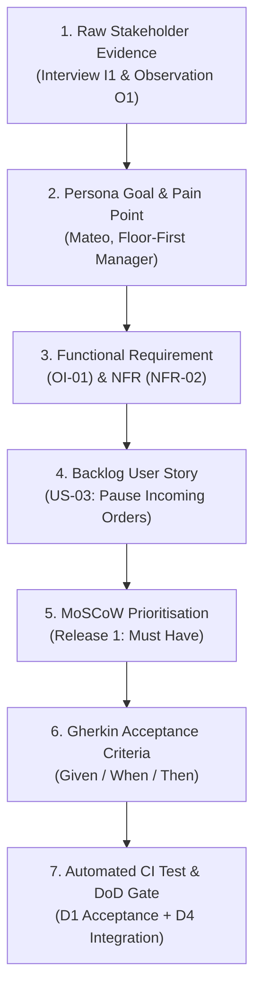

# Optional Submission 2: End-to-End Requirements Traceability Chain
**Student Name:** Nguyen Tung Lam  
**Student ID:** V202603373  
**Group:** Group 10  
**Course:** Advanced Software Engineering (AY 26–27) · VinUniversity  
**Standard:** IEEE 830 / ISO/IEC/IEEE 29148 Traceability Standard  
**Chain Topic:** Order Intake Throttle & Offline Resilience (From Elicitation to Acceptance Testing)



---

## Traceability Thread Breakdown

### Step 1: Raw Elicitation Quote & Field Observation
- **Source:** Interview Note `I1` & Observation `O1` (Dinner Service, 19:15).
- **Verbatim Quote:**
  > *"During the 7:00 PM rush, the delivery tablet chimes non-stop while a line of guests forms at the host stand. My kitchen ticket rail is completely backed up. I need a way to hit pause on delivery orders right from the tablet without having to call customer support, even if our Wi-Fi is flickering."*

### Step 2: Persona Synthesis (Part B)
- **Persona:** Mateo, the Floor-First Manager ([`03_personas.md`](file:///Users/tunglambg131003/SE_LEC2/workspace/03_personas.md))
- **Grounded Goal:** Ensure kitchen pacing remains predictable and manageable for back-of-house staff. `[I2, I4, O2]`
- **Observable Behavior:** Routinely turns off delivery tablet or artificially extends prep times during dinner rushes to throttle order volume. `[I1, I4, O1]`
- **Pain Point:** Lack of quick, reliable controls to regulate order influx when in-house dining peaks. `[I1, O1]`

### Step 3: Formal Requirements Specification (Parts C & D)
- **Functional Requirement (`OI-01`):**
  > *"The system shall pause incoming orders [when manually triggered]."*  
  *(Actor: Restaurant Manager | Source: Mateo [I1, I4, O1])*
- **Coupled Non-Functional Requirement (`NFR-02` - Reliability):**
  > *"The tablet app shall locally queue and successfully sync 100% of state changes (e.g., pausing orders, extending times) to the backend within `[TBC]` seconds of network restoration."*  
  *(Condition: Following localized Wi-Fi dropout | Tested by: Network disconnect/reconnect sync test)*

### Step 4: Backlog Decomposition (Part E)
- **User Story (`US-03`):**
  > *"As Mateo, the Floor-First Manager, I want to manually trigger the system to pause incoming orders, so that I can temporarily throttle delivery volume and prioritize dine-in guests during dinner rushes."*
- **Traceability Linkage:** Directly satisfies `OI-01` and `NFR-02`.

### Step 5: MoSCoW Prioritization (Part F)
- **Category:** **Must Have** (Release 1).
- **Engineering Justification:** Kitchens with no throttle mechanism crash during dinner service, leading to cancelled orders, ruined food, rider disputes, and churn among restaurant partners.

### Step 6: Concrete Gherkin Acceptance Criteria (Part H)
```gherkin
Feature: Pause incoming orders during service rushes
  As a restaurant manager
  I want to pause incoming delivery orders from the tablet
  So that the kitchen is not overwhelmed during peak dining hours

  @edge @reliability
  Scenario: Pause order state successfully syncs after Wi-Fi reconnection
    Given the restaurant tablet is actively accepting orders
    And the restaurant Wi-Fi connection is dropped
    When the manager taps "Pause Incoming Orders" on the tablet
    Then the tablet immediately displays the status "Orders Paused (Offline Queued)"
    And when the Wi-Fi connection is restored
    Then the backend order service receives the pause event within 3 seconds
    And customers attempting to checkout receive the notice "Restaurant is temporarily pausing orders"
```

### Step 7: Automated Test & Definition of Done Verification (Part I)
- **Integration Test (`tests/integration/test_order_throttle.py`):**
  ```python
  def test_offline_pause_sync(tablet_client, mock_backend, network_controller):
      network_controller.disconnect_wifi()
      tablet_client.post("/api/v1/store/pause")
      assert tablet_client.get_local_state()["status"] == "PAUSED_PENDING_SYNC"
      
      network_controller.reconnect_wifi()
      synced = tablet_client.wait_for_sync(timeout_sec=3)
      assert synced is True
      assert mock_backend.get_store_status()["is_accepting_orders"] is False
  ```
- **DoD Quality Gates (D1, D4):** Verified in automated CI pipeline before merge approval.
